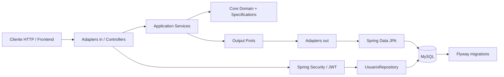

# Análise de arquitetura, requisitos e performance — AutoEscola3ESR

Data da análise: 18/10/2026
Projeto analisado: `/Users/nando_mac/Desktop/CP5-SOA/AutoEscola3ESR`

## 1. Objetivo e escopo

Este documento registra o mapeamento técnico do projeto, sua arquitetura, requisitos funcionais e não funcionais observáveis, métricas de aceite e performance recomendadas, além dos gargalos e riscos identificados no código.

A análise foi baseada em:

- código Java em `src/main/java`;
- testes em `src/test/java`;
- migrações Flyway em `src/main/resources/db/migration`;
- `pom.xml`, propriedades de aplicação e contrato OpenAPI em `SwaggerOffLine.yaml`;
- execução do grafo estrutural do código (`graphify-out/`);
- execução real de `bash mvnw test`.

Classificação usada:

- **Observado**: explicitamente implementado ou declarado no código/configuração;
- **Inferido**: comportamento esperado deduzido do domínio, nomes e fluxos existentes;
- **Não comprovado**: deveria existir como requisito/critério, mas não há evidência suficiente no repositório.

## 2. Resumo executivo

O sistema é uma API REST monolítica modular para uma autoescola. O núcleo funcional é composto por:

1. autenticação de usuários com JWT;
2. cadastro, consulta, atualização e exclusão lógica de instrutores;
3. agendamento de instruções práticas;
4. validação de disponibilidade, horário de funcionamento, antecedência, hora inteira e limite diário do aluno;
5. persistência MySQL versionada por Flyway;
6. documentação OpenAPI/Swagger.

A estrutura de pacotes segue uma variação de arquitetura hexagonal/clean architecture: adaptadores de entrada e saída são separados do núcleo de aplicação, que usa portas e serviços. Entretanto, a implementação ainda é um monólito único, com um único processo e um único banco. Não há evidência de serviços independentes, mensageria, descoberta de serviços ou comunicação assíncrona; portanto, apesar do nome da pasta indicar “SOA”, o artefato atual não é uma arquitetura distribuída orientada a serviços.

Principais conclusões:

- **Ponto positivo:** o domínio de agendamento está organizado em validadores independentes, o que favorece evolução e testes unitários.
- **Risco crítico:** há uma janela de concorrência entre verificar disponibilidade e inserir o agendamento; o banco não possui restrição única aparente para impedir duplicidade.
- **Risco crítico:** `InstrutorEntityMapper.toDomain` não trata `null`, mas a consulta de instrutor disponível pode retornar `null`. O fluxo pode falhar com `NullPointerException` antes de produzir a validação de “nenhum instrutor disponível”.
- **Risco alto:** `order by rand()` na seleção aleatória de instrutor tende a degradar com o crescimento da tabela.
- **Risco alto:** segredos e credenciais estão em `application.properties` versionável: senha MySQL `fiap` e segredo JWT `12345678`.
- **Risco alto:** `AlunoController` está estruturalmente presente, mas todos os métodos retornam `null`; o CRUD de alunos não está implementado.
- **Risco médio:** os testes não são autossuficientes; a execução real falhou por indisponibilidade do MySQL em `localhost`, impedindo comprovar o comportamento de integração.
- **Risco médio:** o tratamento global cobre validação e `EntityNotFoundException`, mas não trata explicitamente `ValidacaoException`, falhas de autenticação, tokens inválidos ou exceções de infraestrutura com um contrato de erro consistente.

## 3. Inventário técnico

### 3.1 Tecnologias identificadas

- Java 25 configurado em `pom.xml`;
- Spring Boot 4.0.5;
- Spring MVC/Web;
- Spring Data JPA/Hibernate;
- MySQL Connector/J;
- Flyway para migrações;
- Spring Security;
- JWT com Auth0 `java-jwt` 4.6.0;
- Bean Validation/Jakarta Validation;
- Springdoc OpenAPI;
- Lombok;
- JUnit/Spring Boot Test/MockMvc;
- Maven Wrapper.

### 3.2 Tamanho observado

- 60 arquivos Java entre produção e testes;
- 8 migrações SQL;
- 393 nós e 972 arestas no grafo estrutural gerado pelo Graphify;
- 12 comunidades estruturais identificadas;
- nenhum ciclo de importação foi identificado pelo grafo;
- a consulta estrutural classificou `Instrutor`, `Especialidade`, `DadosAgendamento`, `Usuario` e `Instrucao` como abstrações centrais.

## 4. Arquitetura atual

### 4.1 Visão em camadas



### 4.2 Estrutura de pacotes

```text
src/main/java/br/com/fiap3esr/autoescola3esr/
├── adapter/in/controller             # REST controllers, requests, responses, mappers
├── adapter/out/repository             # implementação dos ports e mapeamento JPA
│   ├── entity                          # entidades de persistência
│   ├── mapper                          # Entity <-> domínio
│   └── persistence                      # interfaces JpaRepository
├── adapter/out/security                # integração com autenticação/usuário
├── application/core/domain             # entidades e objetos de domínio
├── application/core/specification      # regras de validação de agendamento
├── application/port/in                 # contratos de entrada
├── application/port/out                # contratos de persistência
├── application/service                 # casos de uso/orquestração
├── config                              # segurança e OpenAPI
├── exception                           # handler e exceções de negócio
└── shared                              # value objects e enums
```

### 4.3 Fluxo de autenticação

1. `POST /login` recebe `DadosLogin`.
2. `AuthenticationManager` autentica login e senha.
3. `TokenService` gera JWT HMAC256 com issuer `AutoEscola3ESR` e validade de 30 minutos.
4. Para as demais requisições, `SecurityFilter` lê o header `Authorization`, valida o JWT e recupera o usuário pelo subject.
5. `SecurityConfig` mantém sessão stateless e exige autenticação para qualquer endpoint não explicitamente liberado.
6. Autorizações específicas são feitas com `@PreAuthorize` no `InstrutorController`.

### 4.4 Fluxo de cadastro de instrutor

```text
POST /instrutores
  -> validação do DTO
  -> InstrutorController
  -> InstrutorService.cadastrarInstrutor
  -> InstrutorMapper.toDomain
  -> InstrutorRepository port
  -> InstrutorRepositoryImpl
  -> InstrutorEntityMapper
  -> InstrutorJpaRepository.save
  -> MySQL
  -> resposta 201 + Location
```

### 4.5 Fluxo de agendamento

```text
POST /instrucoes
  -> validação do DTO
  -> AgendaDeInstrucoes.agendar
  -> confirma existência do aluno
  -> confirma existência do instrutor informado, se houver
  -> executa todos os ValidadorAgendamento
  -> escolhe instrutor informado ou disponível por especialidade
  -> persiste Instrucao
  -> retorna detalhamento do agendamento
```

Os validadores observados são:

- `ValidadorAlunoAtivo`;
- `ValidadorInstrutorAtivo`;
- `ValidadorConflitoHorarioInstrutor`;
- `ValidadorHorarioFuncionamento`;
- `ValidadorHorarioAntecedencia`;
- `ValidadorHoraInteira`;
- `ValidadorLimiteDiarioAluno`.

## 5. Requisitos funcionais

### RF-01 — Autenticar usuário

**Status:** Observado.

O sistema deve receber login e senha em `POST /login` e retornar um JWT quando as credenciais forem válidas.

Critérios de aceite:

- dados ausentes devem resultar em `400`;
- credenciais válidas devem resultar em `200` e `tokenJWT` não vazio;
- credenciais inválidas devem resultar em `401`;
- o token deve conter issuer esperado e expiração;
- token inválido ou expirado deve impedir acesso aos endpoints protegidos.

### RF-02 — Cadastrar instrutor

**Status:** Observado.

`POST /instrutores` cria um instrutor e retorna os dados detalhados.

Regras observadas no DTO:

- nome obrigatório;
- e-mail obrigatório e em formato de e-mail;
- telefone obrigatório;
- CNH obrigatória, com 9 a 11 dígitos;
- especialidade obrigatória;
- endereço aninhado validado.

Autorização: somente `ADMIN`.

Critérios de aceite:

- sucesso deve retornar `201 Created`, corpo detalhado e header `Location`;
- payload inválido deve retornar `400` com campo e mensagem;
- usuário sem papel `ADMIN` deve receber `403`;
- instrutor persistido deve aparecer na listagem de ativos.

### RF-03 — Listar instrutores ativos

**Status:** Observado.

`GET /instrutores` retorna uma página, por padrão com tamanho 10 e ordenação por nome.

Autorização: `ADMIN` ou `USER`.

Critérios de aceite:

- somente registros `ativo = true` devem ser retornados;
- paginação e ordenação devem ser respeitadas;
- resposta deve ser `200`;
- exclusão lógica não deve remover fisicamente o registro nem fazê-lo aparecer na listagem ativa.

### RF-04 — Detalhar instrutor

**Status:** Observado.

`GET /instrutores/{id}` retorna os dados detalhados do instrutor.

Autorização: `ADMIN`.

Critérios de aceite:

- ID existente retorna `200`;
- ID inexistente retorna `404`;
- acesso sem papel adequado retorna `403`.

### RF-05 — Atualizar instrutor

**Status:** Observado.

`PUT /instrutores` altera os campos enviados para o instrutor identificado pelo ID.

Autorização: `ADMIN`.

Critérios de aceite:

- ID é obrigatório;
- campos não nulos e não vazios devem ser atualizados;
- endereço deve ser atualizado sem perder os valores existentes quando campos não forem enviados;
- ID inexistente retorna `404`;
- atualização bem-sucedida retorna `200`.

### RF-06 — Excluir instrutor logicamente

**Status:** Observado.

`DELETE /instrutores/{id}` marca `ativo = false`, em vez de excluir fisicamente.

Autorização: `ADMIN`.

Critérios de aceite:

- sucesso retorna `204 No Content` conforme o controller;
- registro não deve aparecer em `GET /instrutores`;
- instrutor inativo não deve ser escolhido para novo agendamento;
- ID inexistente retorna `404`.

### RF-07 — Cadastrar e gerenciar alunos

**Status:** Inferido pelo modelo de portas, DTOs e migrações; implementação atual incompleta.

O sistema aparenta prever CRUD de alunos em `/alunos`, mas `AlunoController` retorna `null` em todos os métodos e `DadosCadastroAluno` é um record vazio.

Critérios de aceite necessários para considerar o requisito implementado:

- definir campos obrigatórios de aluno;
- implementar POST, GET paginado, GET por ID, PUT e DELETE;
- persistir aluno e status ativo;
- aplicar autenticação e autorização explícitas;
- cobrir o fluxo com testes de controller e persistência.

**Conclusão:** não considerar RF-07 entregue no estado atual.

### RF-08 — Agendar instrução

**Status:** Observado, com riscos de robustez.

`POST /instrucoes` recebe aluno, instrutor opcional, especialidade opcional e data/hora.

Regras observadas:

- aluno deve existir;
- instrutor informado deve existir;
- data/hora deve ser futura;
- antecedência mínima de 30 minutos;
- domingo não é permitido;
- horário permitido é de 06:00 até antes de 21:00;
- minutos devem ser zero;
- aluno pode ter no máximo uma instrução no dia;
- instrutor não pode estar ocupado no mesmo horário;
- instrutor precisa estar ativo;
- se o instrutor não for informado, especialidade é obrigatória;
- seleção automática procura instrutor ativo, da especialidade e sem instrução no horário.

Critérios de aceite:

- sucesso retorna `200` atualmente documentado, embora `201 Created` seja mais apropriado para criação de recurso;
- conflito de horário deve retornar erro de negócio previsível, preferencialmente `422` ou `409`;
- falta de instrutor disponível deve retornar erro de negócio, não `NullPointerException`;
- payload inválido deve retornar `400`;
- tentativas simultâneas para o mesmo instrutor/horário devem resultar em apenas um agendamento aceito.

### RF-09 — Health check

**Status:** Observado.

`GET /health-check` retorna texto fixo. O endpoint está listado como público no contrato, mas no `SecurityConfig` não há `requestMatchers("/health-check").permitAll()`; pela regra `.anyRequest().authenticated()`, ele tende a exigir autenticação.

Critério de aceite recomendado:

- endpoint público deve retornar `200` sem JWT;
- resposta deve indicar apenas disponibilidade da aplicação, ou migrar para Spring Actuator para diferenciar liveness e readiness.

### RF-10 — Documentar API

**Status:** Observado.

Há Springdoc configurado e um contrato offline em `SwaggerOffLine.yaml`. O contrato precisa ser mantido alinhado à implementação, pois há divergências prováveis de status HTTP e endpoints ainda incompletos.

## 6. Requisitos não funcionais

### RNF-01 — Segurança de acesso

**Implementação observada:** JWT stateless, BCrypt, autorização por papel e CORS configurado.

**Lacunas/riscos:**

- segredo JWT fraco e exposto em arquivo de configuração;
- senha do banco exposta;
- tratamento de token malformado não está explicitamente convertido em `401`;
- `Authorization` é processado com `replace("Bearer ", "")`, aceitando formatos fora do padrão sem validação estrita;
- endpoint de health check não está explicitamente público;
- CORS contém origens específicas, mas a configuração deve ser externalizada por ambiente.

### RNF-02 — Disponibilidade e operabilidade

**Implementação observada:** existe health check textual.

**Meta recomendada:**

- liveness p95 < 100 ms sem banco;
- readiness deve verificar banco e migrações;
- logs estruturados com correlation/request ID;
- métricas de erro, latência, pool de conexões e agendamentos rejeitados.

### RNF-03 — Consistência dos agendamentos

**Implementação observada:** várias verificações antes da inserção.

**Lacuna crítica:** validações de existência/conflito e inserção não formam uma operação atomicamente protegida contra concorrência. É necessário complementar a regra de aplicação com proteção no banco e tratamento de conflito.

### RNF-04 — Escalabilidade

**Implementação observada:** paginação de instrutores.

**Lacunas:**

- seleção aleatória com `ORDER BY RAND()`;
- ausência de índices explícitos visíveis para as buscas de disponibilidade;
- possível contagem adicional de paginação;
- múltiplas consultas sequenciais no agendamento;
- um único monólito e um único banco limitam escala independente por capacidade funcional.

### RNF-05 — Manutenibilidade

**Pontos positivos:** separação entre ports/adapters, serviços e validadores; ausência de ciclos de importação no grafo.

**Lacunas:** injeção de dependência mista (construtor em alguns pontos, `@Autowired` em campos em outros), controller de aluno incompleto, DTO vazio e pouca cobertura de testes para regras de negócio.

### RNF-06 — Observabilidade

**Status:** Não comprovado.

Não foram encontrados, na análise, indicadores de métricas Micrometer/Prometheus, tracing distribuído, logging estruturado ou dashboards.

### RNF-07 — Portabilidade de ambiente

**Status:** Parcial.

Há perfil de teste, mas ele ainda depende de MySQL em `localhost`. A execução da suíte falhou por `Connection refused`, mostrando que o ambiente de teste não é reproduzível sem banco externo disponível.

## 7. Métricas de aceite recomendadas

As metas abaixo são propostas para transformar os requisitos em critérios verificáveis. Elas não estão explicitamente configuradas no código e devem ser validadas com carga representativa.

| Área | Métrica | Meta inicial | Como medir |
|---|---|---:|---|
| API | taxa de respostas 2xx em fluxo válido | >= 99% | teste de integração/carga |
| API | respostas 4xx esperadas para payload inválido | 100% dos cenários | testes de contrato |
| API | `GET /instrutores` p95 | <= 300 ms | k6/JMeter + banco com massa |
| API | `POST /instrucoes` p95 | <= 500 ms | k6/JMeter com concorrência |
| API | `POST /login` p95 | <= 400 ms | teste de carga controlado |
| API | erro 5xx em carga nominal | < 1% | observabilidade + relatório de carga |
| Agendamento | duplicidade para mesmo instrutor/horário | 0 | teste concorrente + constraint DB |
| Agendamento | conflito corretamente rejeitado | 100% | testes de integração |
| Segurança | endpoint protegido sem token | 100% bloqueado | testes de segurança |
| Segurança | token inválido/expirado | 100% retorna 401 | testes de filtro |
| Paginação | tamanho máximo efetivo | definido e validado | testes de controller |
| Banco | consultas críticas sem full scan | 100% das consultas críticas | `EXPLAIN`/`EXPLAIN ANALYZE` |
| Build | testes passantes em ambiente limpo | 100% | CI com banco efêmero |
| Cobertura | regras de agendamento cobertas | >= 90% | JaCoCo + testes unitários |

## 8. Gargalos e riscos priorizados

### G-01 — Concorrência no agendamento — severidade crítica

**Evidência:** `AgendaDeInstrucoes` consulta disponibilidade e depois executa `repository.save`, enquanto a migração `V7` não declara constraint única para `instrutor_id + data_hora`.

**Impacto:** dois requests simultâneos podem validar o mesmo horário como livre e inserir dois agendamentos.

**Correção recomendada:**

1. adicionar índice/constraint única para `(instrutor_id, data_hora)`;
2. manter validação amigável na aplicação;
3. capturar `DataIntegrityViolationException` e convertê-la para conflito de negócio;
4. testar com múltiplas threads/requests simultâneos.

### G-02 — `ORDER BY RAND()` — severidade alta

**Evidência:** query em `InstrutorJpaRepository` usa `order by rand() limit 1`.

**Impacto:** pode avaliar e ordenar muitos registros a cada agendamento automático.

**Correção recomendada:** selecionar candidatos por índice e escolher um offset/ID aleatório, ou usar estratégia de distribuição/round-robin. Confirmar com `EXPLAIN ANALYZE`.

### G-03 — Mapper sem tratamento de ausência — severidade crítica

**Evidência:** `InstrutorRepositoryImpl.escolherInstrutorAleatorioDisponivel` chama `entityMapper.toDomain(entity)` diretamente; `toDomain` acessa getters sem verificar `null`; `AgendaDeInstrucoes` só verifica `instrutor == null` depois.

**Impacto:** a mensagem planejada “não existe instrutor disponível” pode nunca ser executada; o usuário pode receber erro 500.

**Correção recomendada:** retornar `Optional<Instrutor>` da porta/repositório ou tratar `null` no mapper antes de montar a entidade.

### G-04 — Validações com ID opcional — severidade alta

**Evidência:** `ValidadorConflitoHorarioInstrutor` e `ValidadorInstrutorAtivo` usam `dados.idInstrutor()` sem evidência de tratamento para `null`, embora o instrutor seja opcional.

**Impacto:** consultas com parâmetro nulo, validações semanticamente incorretas ou falhas dependentes do banco.

**Correção recomendada:** validadores que dependem de instrutor informado devem sair imediatamente quando `idInstrutor == null`; a disponibilidade automática deve ser validada no fluxo de seleção.

### G-05 — Credenciais e segredo no código/configuração — severidade alta

**Evidência:** `application.properties` contém URL, usuário, senha e `api.security.token.secret`.

**Impacto:** comprometimento de banco e falsificação de tokens se o repositório for compartilhado.

**Correção recomendada:** variáveis de ambiente/secret manager, rotação imediata dos valores atuais, configuração por perfil e bloqueio de segredos no CI.

### G-06 — CRUD de alunos incompleto — severidade alta

**Evidência:** `AlunoController` possui cinco métodos que retornam `null`; `DadosCadastroAluno` não possui campos.

**Impacto:** o fluxo de agendamento depende de alunos, mas não há API funcional para cadastrar ou manter esses registros.

**Correção recomendada:** definir contrato de aluno, implementar serviço/port/adapters e adicionar testes de aceitação.

### G-07 — Testes dependentes de MySQL externo — severidade alta

**Evidência:** `application-test.properties` aponta para `localhost:3306/autoescola3esr_test`; `bash mvnw test` terminou com `Connection refused` durante Flyway/ApplicationContext.

**Impacto:** build não reproduzível em máquina limpa e CI frágil.

**Correção recomendada:** usar Testcontainers MySQL ou banco efêmero equivalente; separar testes unitários puros de testes de integração; documentar pré-requisitos quando um banco externo for inevitável.

### G-08 — Contrato HTTP inconsistente — severidade média

**Evidência:** OpenAPI registra vários sucessos como `200`, mas o controller de criação de instrutor retorna `201` e exclusão retorna `204`.

**Impacto:** clientes gerados e testes de contrato podem interpretar respostas incorretamente.

**Correção recomendada:** gerar/atualizar o contrato a partir da implementação e adicionar testes de contrato.

### G-09 — Tratamento de exceções incompleto — severidade média

**Evidência:** `GlobalExceptionHandler` trata `EntityNotFoundException` e `MethodArgumentNotValidException`, mas não há handler explícito para `ValidacaoException`, falhas de autenticação, falhas de autorização ou conflitos de integridade.

**Impacto:** respostas 500 ou formatos inconsistentes para erros esperados.

**Correção recomendada:** definir envelope de erro versionado, códigos HTTP por categoria e handlers específicos.

### G-10 — Persistência com possíveis objetos de domínio acoplados ao JPA — severidade média

**Evidência:** `Instrucao`, `Instrutor` e outros objetos do núcleo usam anotações JPA; existe também `InstrutorEntity` separado.

**Impacto:** fronteira hexagonal incompleta e maior acoplamento entre domínio e infraestrutura.

**Correção recomendada:** escolher uma estratégia consistente: domínio puro + entidades de persistência separadas, ou documentar conscientemente o compromisso.

## 9. Plano de testes recomendado

### 9.1 Testes unitários

- cada `ValidadorAgendamento` isoladamente;
- combinação de validadores no caso de uso;
- escolha automática sem instrutor disponível;
- mapper com entidade nula e `Optional`;
- atualização parcial de instrutor;
- exclusão lógica;
- parsing e expiração de JWT;
- tratamento de token ausente, malformado e expirado.

### 9.2 Testes de integração

- migrations Flyway em banco limpo;
- CRUD de instrutor;
- CRUD de aluno após implementação;
- agendamento com instrutor explícito;
- agendamento por especialidade;
- conflitos de aluno/instrutor;
- constraints de banco;
- autorização por `ADMIN` e `USER`;
- respostas HTTP alinhadas ao OpenAPI.

### 9.3 Testes concorrentes

Cenário mínimo:

1. criar um aluno e um instrutor;
2. disparar N requests para o mesmo horário;
3. validar que apenas uma instrução foi criada;
4. validar que os demais retornaram conflito controlado;
5. verificar que não houve erro 500.

### 9.4 Testes de performance

Massa inicial recomendada:

- 10 mil instrutores;
- 100 mil instruções;
- distribuição realista por especialidade e data/hora;
- concorrência de 10, 50 e 100 usuários;
- medir p50, p95, p99, throughput, CPU, memória, pool JDBC e tempo de consulta.

## 10. Roadmap técnico priorizado

### P0 — antes de considerar produção

1. remover segredos do repositório e rotacionar os valores atuais;
2. corrigir retorno nulo do mapper/seleção automática;
3. blindar concorrência com constraint única e tratamento de conflito;
4. corrigir validadores que recebem instrutor opcional;
5. tornar testes executáveis com banco efêmero;
6. definir handlers de erro para regras de negócio e autenticação;
7. decidir e implementar o escopo de alunos.

### P1 — qualidade e contrato

1. alinhar Swagger/OpenAPI aos status HTTP reais;
2. adicionar testes de autorização e contrato;
3. substituir injeção em campo por injeção via construtor;
4. centralizar configuração de CORS e duração do JWT;
5. adicionar observabilidade básica;
6. definir limite máximo de paginação.

### P2 — performance e evolução

1. remover `ORDER BY RAND()`;
2. criar índices comprovados por `EXPLAIN ANALYZE`;
3. instrumentar métricas de agendamento;
4. avaliar separação de módulos/deploys apenas se houver necessidade de escala independente;
5. adicionar pipeline CI com build, testes, análise estática e verificação de segredos.

## 11. Verificação executada

### Graphify

Foi gerado o grafo estrutural em:

- `graphify-out/graph.json`;
- `graphify-out/GRAPH_REPORT.md`;
- `graphify-out/graph.html`.

O processamento cobriu a estrutura de código. Arquivos SQL não foram totalmente representados no AST porque o extrator informou ausência de `tree_sitter_sql`; por isso, as conclusões de banco foram confirmadas diretamente pelas migrações e interfaces de repositório.

### Maven/testes

Comando executado:

```bash
bash mvnw test
```

Resultado real: `BUILD FAILURE`, com 4 testes executados e 4 erros de carregamento de contexto. A causa foi indisponibilidade do MySQL de teste em `localhost:3306`, terminando em `Connection refused` durante a inicialização do Flyway. Isso não comprova que todos os testes falhariam com a infraestrutura correta; comprova que a suíte atual depende de um banco externo não disponível no ambiente analisado.

O primeiro comando `./mvnw test` também falhou antes da execução porque o arquivo `mvnw` não possui permissão de execução; a execução via `bash mvnw test` contornou essa limitação sem alterar o arquivo.

## 12. Conclusão

A base possui uma boa direção arquitetural para uma API de domínio: separa entradas, casos de uso, portas, persistência e regras de agendamento. A principal fragilidade não é a ausência de camadas, mas a diferença entre a intenção arquitetural e a robustez operacional da implementação.

Antes de evoluir para uma arquitetura distribuída ou adicionar novas funcionalidades, a prioridade deve ser tornar o fluxo de agendamento determinístico, transacional e observável; remover segredos; completar alunos; estabilizar a suíte de testes; e alinhar o contrato HTTP. Depois dessas correções, os indicadores de latência, concorrência e qualidade poderão ser medidos de forma confiável.
